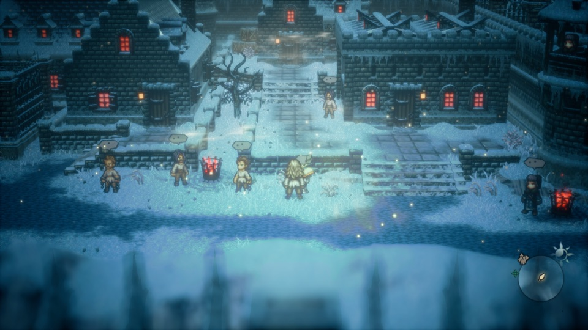
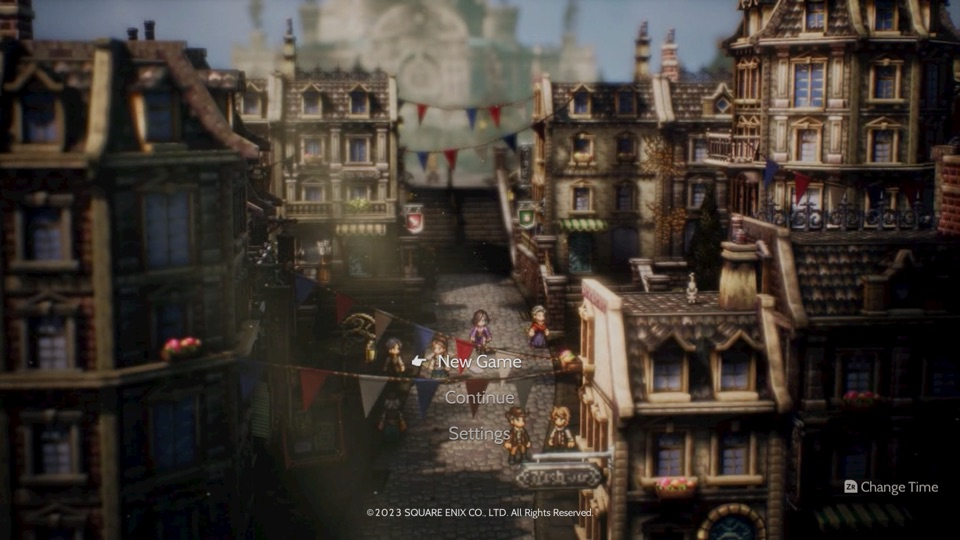
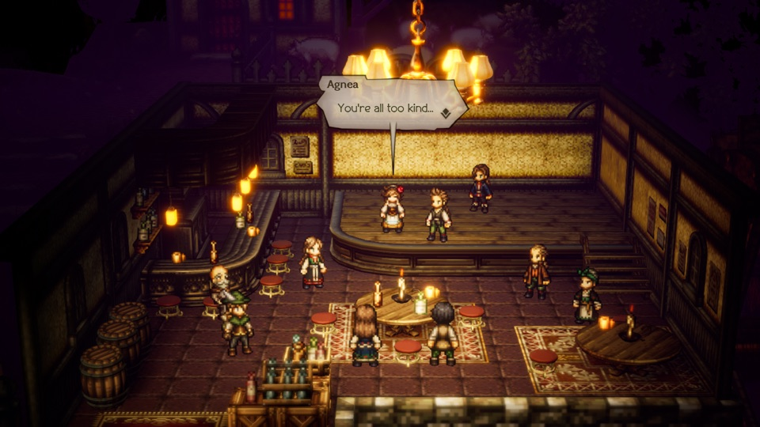
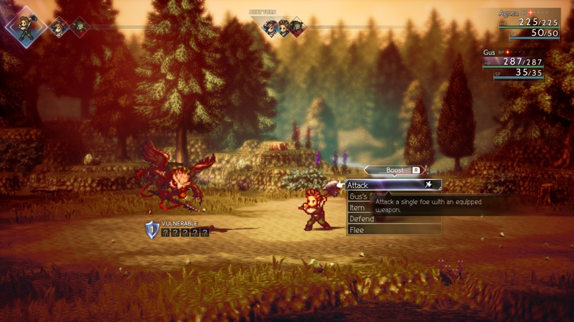

# OT2 Mobile

**八方旅人 II，原生运行在 Mac 上，下一步是 iPhone。** 本项目是 [nxnative](https://github.com/seedds/nxnative) 的分支，把 Nintendo Switch 版《八方旅人 II》（1.1.1）带到苹果设备上：游戏自己的 arm64 程序直接在苹果芯片上执行，图形在 Metal 上重建。项目新增了经典 Metal（Metal 3）图形后端，因此可以在 **macOS 15 / iOS 18** 上运行，不必等 Metal 4。

平台：Mac（Apple 芯片，macOS 15 及以上）· iPhone（A17 Pro 及以上，iOS 18 及以上；能打包，尚未在真机上测试）· 游戏版本：Switch 1.1.1 · 许可：MIT · **需自备游戏文件**

English: [README.md](README.md)

<p align="center">
  
</p>
<p align="center">
  
  
  
</p>

## 当前状态

| | |
|---|---|
| Mac | 新游戏 → Agnea 在酒馆的序章 → 走出酒馆到村子 → 第一场战斗（攻击、增强、破防）→ 存档后读档：全部可用，有声音，帧率为游戏原生的 30 帧。 |
| 稳定性 | 实测在标题画面轮播场景下连续运行 2 小时、在酒馆运行 31 分钟，均无崩溃；Mac 上常驻内存峰值约 2.6 GB。内存仍有缓慢增长（约每小时 0.45 GB），超过约 2 小时的连续游玩尚未测试。 |
| Shader | 构建时直接从你的游戏文件提取游戏的全部 shader（62,547 条记录，去重后 13,942 个），不需要先玩一遍，去新地方也不会缺画面。 |
| iPhone | 未签名的 iOS 18 应用可以编译（A17 Pro 及以上），**尚未在真机上运行过**。 |


## 它是什么，不是什么

**它是：**

- 游戏自己的程序**直接在 Apple 芯片上执行**，没有模拟 CPU。只改写极少数在苹果内核下无法原样运行的指令（nxnative 的 NSO 改写器）。
- nxnative 提供的 Switch 系统服务宿主，加上一个从 [d2r-mobile](https://github.com/jhaizhou-ops/d2r-mobile) 的 `DM_NVN_M3` 分支演化来的**经典 Metal NVN 后端**，所以能在 macOS 15 / iOS 18 上运行，不需要 Metal 4。
- 一份《八方旅人 II》1.1.1 的游戏配置（`dm/games/0100A3501946E000/`）：虚幻引擎内存分配器替换、内存布局，以及它需要的 UE4 shader 处理。

**它不是：**

- 模拟器、云游戏或串流。
- **游戏内容的来源。** 仓库里没有任何游戏程序、美术、文本、数据或 shader，一切都在你自己的电脑上，用你自己的游戏备份和密钥生成。
- 联网游戏。游戏完全离线运行。

## 相对 nxnative 新增了什么

| 改动 | 位置 |
|---|---|
| 面向 macOS 15 / iOS 18 的经典 Metal（Metal 3）NVN 后端，来自 d2r-mobile，并加入八方旅人 II 的修复 | `dm/host/m3_routea_*`、`dm/host/m3gfx/` |
| 虚幻引擎 4 内存分配器替换：用宿主的 malloc zone 代替 FMallocBinned3，让游戏能放进 3 GB 虚拟地址空间 | `dm/host/hle_uemalloc.c`、`dm/games/0100A3501946E000/patches.py` |
| UE4 第 11 版 PAK 内嵌 shader 提取，以及对无法静态提取的 shader 的运行时截取兜底 | `dm/gfx/tools/uepak.py`、`shader_split.py`、`nvn_capture_split.py` |
| 静态提取八方旅人 II 的全部 shader 记录（UEXP 材质与全局缓存：每条是 4 字节长度加一个 LZ4 块），并与运行时截取按内容键合并 | `dm/gfx/tools/ot2_uexp_static.py` |
| 从上游 nxnative 移植进经典后端：整数片元输出、把只选层的 geometry shader 折叠为分层顶点 shader（UE 的 3D 调色表）、按 NVN 深度模式选择入口 | `dm/host/m3_routea_nvn_mtl.m` |
| 更顺手的 Mac 键盘映射：回车 / 空格确认，Esc 取消 | `dm/host/front_mac.m` |

## 上手（Mac）

需要：Apple 芯片的 Mac，macOS 15 及以上，Xcode 16 及以上；你自己的**《八方旅人 II》**备份（XCI 或 NSP，1.1.1 版）以及你主机的 `prod.keys`。

> 本项目只提供工具，不含任何游戏内容；不分发、不认可、也不对任何人分发游戏文件或含游戏内容的安装包负责。请只使用你合法拥有的游戏。

**1. 获取代码和工具**（与 nxnative 相同）：

```
git clone https://github.com/leeashine/ot2-mobile.git && cd ot2-mobile
brew install xcodegen zstd spirv-cross glslang
brew install --cask dotnet-sdk
python3 -m pip install lz4 capstone fonttools "backports.zstd; python_version < '3.14'"
```

请选择完整的 Xcode 工具链。安装多个 Xcode 版本时，优先为当前 shell 设置作用域内的 `DEVELOPER_DIR`，避免影响其他项目：

```sh
export DEVELOPER_DIR="/Applications/Xcode.app/Contents/Developer"
xcodebuild -version
xcrun --sdk iphoneos --show-sdk-path
xcrun -find metal
```

也可以用 `sudo xcode-select --switch "/Applications/Xcode.app/Contents/Developer"` 修改系统级选择。选中的 Xcode 必须包含 iOS SDK 和 Metal 工具。

**2. 构建 Mac 版**，参数是存放游戏备份的文件夹：

```
python3 scripts/build_ipa_from_nsp.py ~/Games/OT2 -k ~/keys/prod.keys --platform mac
```

经典 Metal 图形源码已随仓库内置；无需设置 `M3_GFX_DIR`。

脚本会解包游戏、改写代码模块、翻译能找到的 shader、编译 Mac 宿主，最后打印启动游戏的命令。

对于启用了 NVN 运行时截取、且静态切分结果为 0 的 profile，Mac 构建会无窗口启动游戏来采集运行时 shader，然后构建这些 shader。若 profile 配置了 `nvn_capture_keys`，会按其 `DM_KEYS` 输入推进；该采集启动与构建完成后打印的交互式游戏命令相互独立。

要补齐首次启动未覆盖区域的 shader，先用打印的 Mac 命令启动并游玩到目标区域，然后重新运行构建：

```sh
python3 scripts/build_ipa_from_nsp.py ~/Games/OT2 -k ~/keys/prod.keys --platform mac --capture-more
```

`--capture-more` 会合并完整的本地截取并重建，不会再次自动启动无窗口采集流程。

**3. 开始玩。** 先用鼠标点一下游戏窗口。实体手柄（Xbox、PlayStation、Switch Pro）可以直接用，也最顺手。键盘按键：

| 按键 | 对应 |
|---|---|
| W A S D | 移动（左摇杆） |
| 方向键 | 十字键 / 菜单选择 |
| 回车 / 空格 | A — 确认、对话 |
| Esc / 退格 | B — 取消 |
| X / Tab | X — 主菜单 |
| Y | Y |
| Q / E、Z / C | L / R、ZL / ZR |
| P / O | + / − |

## 上手（iPhone）

<!-- TODO(verify): 真机测试后补充 IPA 打包步骤。 -->

同一个脚本可以打包面向 iOS 18 的未签名 IPA（A17 Pro 及以上）。签名时请加上 **Increased Memory Limit** 权限（`com.apple.developer.kernel.increased-memory-limit`）。目前还没有在真机上运行过，欢迎反馈。

## 已知限制

| 项目 | 状态 |
|---|---|
| Shader 覆盖 | 游戏文件里的每一条 shader 记录都能静态解码（每条是 4 字节长度加一个 LZ4 块）。首次 Mac 构建可能还会在后台无窗口启动一次游戏，并合并运行时截取的结果；之后再玩，可用 `--capture-more` 合并新的截取。首次构建要把 13,942 个 shader 全部翻译成 Metal，耗时会更长。 |
| iPhone | 能编译，尚未真机测试。 |
| 设备 | Mac 和 iPhone 版面向 Apple 芯片（A17 Pro / M1 及以上），不支持 Intel Mac。 |
| 联网 | 不在范围内。 |

## 工作原理

| 部分 | 位置 | 作用 |
|---|---|---|
| 改写器 | `dm/tools` | 改写在苹果内核下无法原样运行的少数指令 |
| 宿主 | `dm/host` | 加载改写后的程序，提供 Switch 系统服务 |
| 图形 | `dm/host/m3_routea_*`、`dm/gfx` | 在经典 Metal 上实现 NVN；shader 由游戏原始 shader 离线翻译（Ryujinx 翻译器 → SPIR-V → SPIRV-Cross → Metal） |
| 游戏配置 | `dm/games/0100A3501946E000` | 八方旅人 II 专用的内存布局与补丁 |
| iOS 应用 | `dm/ios` | nxnative 的应用外壳 |

细节见 nxnative 的 [docs/development.md](docs/development.md)，以及本分支的记录 [docs/ot2-macos-trial.md](docs/ot2-macos-trial.md)。

## 法律声明

**你必须拥有这款游戏。** 这是一个独立、非商业、以学习为目的的项目，与 Square Enix 和任天堂没有任何关联，也未获其认可或赞助。OCTOPATH TRAVELER 是 Square Enix 的商标；Nintendo Switch 是任天堂的商标。截图来自作者自己的游戏，仅用于展示项目，游戏内容归其权利人所有。

## 致谢

- **[nxnative](https://github.com/seedds/nxnative)**（seedds，MIT）：本分支所基于的宿主、改写器、shader 流水线、游戏配置体系和 iOS 外壳，以及移植进经典后端的上游修复。
- **[d2r-mobile](https://github.com/jhaizhou-ops/d2r-mobile)**（jhaizhou，MIT）：原生执行的思路，以及经典 Metal 的 `DM_NVN_M3` 后端。
- **Ryujinx / Ryubing**（MIT）：shader 翻译器。
- nxnative 致谢的全部项目——Atmosphère、LibHac、SPIRV-Cross、glslang、deko3d、libvpx、stb_vorbis 等——见 [dm/third_party](dm/third_party/README.md) 和 [THIRD-PARTY-NOTICES.md](THIRD-PARTY-NOTICES.md)。

## 许可

MIT，见 [LICENSE](LICENSE)。第三方代码保留各自的许可，见 [THIRD-PARTY-NOTICES.md](THIRD-PARTY-NOTICES.md)。
